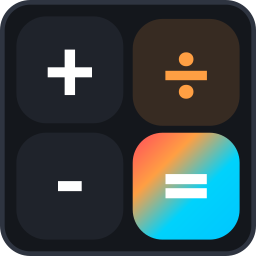

<div align="center">

  

  # CIBO Calculator

  **A modern, versatile desktop calculator and unit conversion suite with 30+ handcrafted themes, acrylic transparency, and advanced mathematical tools.**

  [](LICENSE)
  [-orange.svg)](#requirements)
  [](https://www.electronjs.org/)
  [](#)
  [](https://aselens.com)

</div>

---

## 🌟 Overview

**CIBO Calculator** is an aesthetically refined, feature-packed desktop calculator engineered to combine the clean usability of classic desktop calculators with modern design systems and advanced calculation capabilities. Built with native Linux desktop environments in mind (KDE Plasma, GNOME, etc. on both Wayland and X11), CIBO provides its own custom, frameless Client-Side Decoration (CSD) titlebar controls, responsive tactile audio feedback, global persistence, and 18 dedicated calculation and conversion modes.

---

## ✨ Key Features

### 🧮 18 Dedicated Calculation & Converter Modes
- **Calculator Modes**:
  - **Standard**: Streamlined, distraction-free keypad for daily arithmetic calculations.
  - **Scientific**: Full trigonometric, logarithmic, exponential, powers, roots, factorials, radians/degrees, and constant operators (`π`, `e`).
  - **Graphing**: Real-time 2D Cartesian function plotter with zoom, pan, and formula presets (`y = f(x)`).
  - **Programmer**: Base conversions across **HEX**, **DEC**, **OCT**, and **BIN** with bitwise operations (`AND`, `OR`, `XOR`, `NOT`, `Lsh`, `Rsh`).
  - **Date Calculation**: Calculate exact differences between two dates (years, months, weeks, days) or add/subtract time intervals to find future/past dates.
- **13 Unit Converters**:
  - **Currency (Exchange Rates)**, **Volume & Liquid**, **Length**, **Weight & Mass**, **Temperature**, **Energy**, **Area**, **Speed**, **Time**, **Power**, **Digital Data**, **Pressure**, and **Angle**.

### 🎨 30+ Handcrafted Themes (60 Variations)
Switch between 30 unique visual themes, each supporting dedicated **Light** and **Dark** variations:
- **Default** (Clean adaptive neutral)
- **Apple iOS** (Minimalist Cupertino aesthetics)
- **Windows 11** (Fluent Mica / Acrylic design)
- **Claymorphism** (Soft 3D pillowy buttons)
- **Cybercore** & **Cyberpunk** (High-tech neon glow)
- **Neobrutalism** (High contrast, bold strokes & hard shadows)
- **Scrapbook** (Handcrafted textured collage)
- **Pixelart** (8-bit retro arcade aesthetic)
- **Glassmorphism** (Frosted glass refraction)
- **Neumorphism** (Soft inset and outset skeuomorphic shadows)
- **Wabi Sabi** (Warm Japanese organic minimalism)
- **AMOLED** (Pure deep black battery-saving contrast)
- **Matrix**, **Pastel**, **Solarized**, **Nord**, **Dracula**, **Sunset**, **Synthwave**, **Monokai**, **Forest**, **Coffee**, **Terminal**, **Retro Beige**, **Midnight Blue**, **Luxury Gold**, **Lavender Mist**, **Paper**, and **High Contrast**.

### 💎 Independent Acrylic Transparency Controls
- **Dual-Layer Glass Engine**:
  - Toggle background window transparency on and off.
  - Choose between **Solid Prominent Buttons** (high-contrast, distinct operator colors) or **Transparent Acrylic Keys** (frosted blur effect).
- Works cleanly on both Wayland and X11 compositors.

### 📝 Expression Parser & Clipboard Integration
- **Complex Formula Evaluation**: Enter or paste long mathematical expressions in one shot (e.g. `100*(10-7)/6` or `sin(45) + sqrt(16)`).
- **Clipboard Support**: Full `Ctrl+C` copy, `Ctrl+V` paste, and a customized right-click context menu.
- **Accidental Click Protection**: Left-clicking the result display will not overwrite your system clipboard.

### 💾 Global Persistent History & Memory System
- **State Persistence**: Calculation history and memory entries are automatically saved and restored across app restarts until explicitly wiped.
- **Full Memory Bar**: Windows-style `MC`, `MR`, `M+`, `M-`, `MS`, and `M▾` flyout drawer with one-click recall, individual deletion, and auto-capped memory safety (RAM-leak free).

### ⌨️ Customizable Keyboard Shortcuts
- Quick navigation between modes using default shortcuts (`Alt + 1` through `Alt + 9`, etc.).
- **Interactive Remapper**: Rebind shortcuts for any of the 18 modes inside the settings modal.
- **Isolated Left-Alt**: Custom handling ensures right-side `AltGr` remains available for special character keys (`@`, `€`, `₺`, `\`, etc.).

### 🔊 Theme-Specific Synthesized Audio
- Built-in Web Audio API synthesizer that produces real-time tactile click sounds matched to the active theme (retro 8-bit blips for Pixelart, mechanical clicks for Terminal, soft pops for Claymorphism, and subtle clicks for modern themes). Can be toggled on/off instantly.

### 🌍 Multilingual (i18n)
- 12 fully localized global languages with automatic system language detection:
  - English, Turkish (Türkçe), German (Deutsch), French (Français), Spanish (Español), Italian (Italiano), Portuguese (Português), Russian (Русский), Japanese (日本語), Chinese (简体中文), Arabic (العربية), and Korean (한국어).

---

## 🚀 Getting Started

### Prerequisites
- **Node.js**: `v18.0.0` or higher
- **npm**: `v9.0.0` or higher
- **Operating System**: Linux (Ubuntu, Debian, Fedora, Arch Linux, openSUSE, etc.)

### Installation from Source
1. **Clone the repository**:
   ```bash
   git clone https://github.com/aselens/cibo-calculator.git
   cd cibo-calculator
   ```

2. **Install dependencies**:
   ```bash
   npm install
   ```

3. **Start the application**:
   ```bash
   npm start
   # or run directly with the included launcher:
   ./hesapmakinesi
   ```

4. **Run test suite**:
   ```bash
   npm test
   ```

---

## 📦 Packaging & Distribution

Pre-configured packaging manifests and distribution guides are included in the [`packaging/`](packaging/) folder:

### 1. Flatpak / Flathub
CIBO Calculator includes a complete Flatpak manifest (`com.aselens.CiboCalculator.yml`) and AppStream metadata specification (`com.aselens.CiboCalculator.metainfo.xml`).
See [Flathub Submission Guide](packaging/flatpak/flathub-submission-guide.md) for details on submitting to Flathub.

To build and test locally with `flatpak-builder`:
```bash
flatpak-builder --force-clean --user --install build-dir packaging/flatpak/com.aselens.CiboCalculator.yml
```

### 2. Arch Linux (AUR)
Ready-to-publish `PKGBUILD` and `.SRCINFO` files are provided in `packaging/aur/`.
See [AUR Submission Guide](packaging/aur/aur-submission-guide.md) for step-by-step instructions.

To install using an AUR helper:
```bash
yay -S cibo-calculator
```

---

## 🗂️ Project Structure

```
cibo-calculator/
├── index.html           # Main user interface & views
├── main.js              # Electron main process & IPC handlers
├── preload.js           # Secure context-isolated preload bridge
├── renderer.js          # Core calculator logic, converters & UI controllers
├── i18n.js              # 12-language internationalization dictionary
├── styles/
│   ├── main.css         # Base layout, typography, controls & components
│   └── themes.css       # 30 handcrafted theme color systems & effects
├── tests/
│   └── test_app.js      # Headless Electron automated integration test suite
├── packaging/
│   ├── flatpak/         # Flatpak manifest, AppStream metainfo & Flathub guide
│   └── aur/             # Arch PKGBUILD, .SRCINFO, launcher & AUR guide
├── icon.svg             # Vector application logo
├── icon.png             # 256x256 high-resolution application icon
├── package.json         # Project metadata & npm scripts
└── LICENSE              # MIT Open Source License
```

---

## 🤝 Contributing

Contributions, issues, and feature suggestions are always welcome!
1. Fork the Project
2. Create your Feature Branch (`git checkout -b feature/AmazingFeature`)
3. Commit your Changes (`git commit -m 'Add some AmazingFeature'`)
4. Push to the Branch (`git push origin feature/AmazingFeature`)
5. Open a Pull Request

---

## 📄 License

Distributed under the **MIT License**. See [`LICENSE`](LICENSE) for more information.

---

## 🏢 About

Developed with ❤️ by **[Aselens Software](https://aselens.com)**.
For inquiries, support, or partnerships, visit [aselens.com](https://aselens.com).
